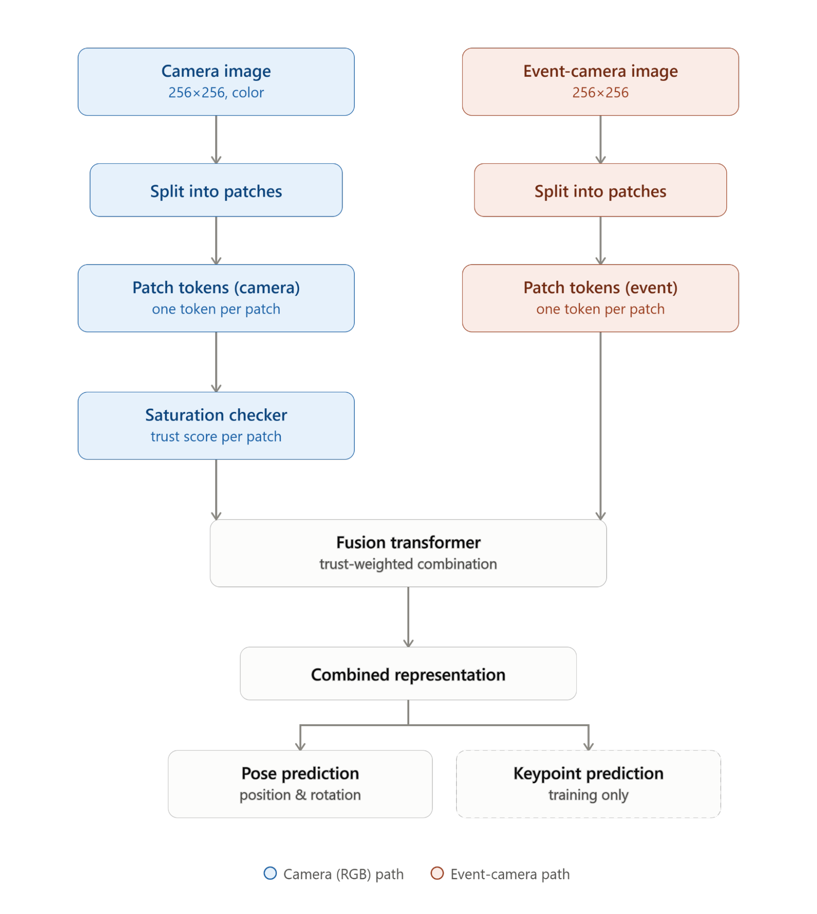

# Saturation-Gated Attention Fusion for Event–RGB Spacecraft Pose Estimation Under Harsh Lighting

Semester project for **CMPE 249: Intelligent Autonomous Systems**, Fall 2026, San José State University.

**Repository:** [Jasper-256/cmpe-249-project](https://github.com/Jasper-256/cmpe-249-project)

## Team members

- Advait Shinde
- Jasper Morgal

## Abstract

Vision-based relative pose estimation supports autonomous spacecraft rendezvous, docking, and on-orbit servicing. Harsh lighting can saturate RGB images and obscure the structure needed to estimate a target's position and orientation. This project investigates whether aligned event-camera data and a compact saturation-gated attention mechanism can improve six-degree-of-freedom spacecraft pose estimation under these conditions.

The proposed model combines RGB and event-camera patch representations using a gate that adjusts each modality's contribution according to local RGB saturation. We hypothesize that this physically grounded constraint can reduce overfitting to synthetic training data while retaining the flexibility of attention-based fusion. Using the FRESH dataset, we will train on synthetic data and evaluate on real harsh-lighting sequences. Comparisons will include RGB-only, event-only, fully learned attention, classical RANSAC fusion, and a parameter-matched control. Evaluation will measure rotation and translation errors, the synthetic-to-real generalization gap, and the gate's behavior. The goal is to test whether constrained attention improves generalization and to characterize accuracy, interpretability, and compute trade-offs, including if the hypothesis is not supported.

## Selected track

**Multimodal Perception and Sensor Fusion for Autonomous Systems**

## Proposed Architecture Diagram



## Project proposal

See the [project proposal](docs/project-proposal.md) for the problem formulation, architecture, success criteria, datasets, and available hardware.

## Research roadmap

The active [execution plan](plan.md) tracks the end goal, phase gates, current
status, fallback strategies, and decision log. The longer
[research and experimentation roadmap](docs/research-roadmap.md) defines the
frozen-test protocol, model controls, statistical analysis, twelve-week schedule,
and go/no-go criteria. Material web-verified decisions are tracked in the
[research log](docs/research-log.md).

## Development environment

The project uses Python 3.12 and `uv` with a locked CUDA-enabled PyTorch stack:

```powershell
uv sync --all-groups --all-extras
uv run python scripts/verify_environment.py
uv run ruff check .
uv run pytest
```

Raw datasets, external baseline checkouts, checkpoints, and experiment outputs
must remain outside version control; see [AGENTS.md](AGENTS.md) for the scientific
and engineering invariants.
