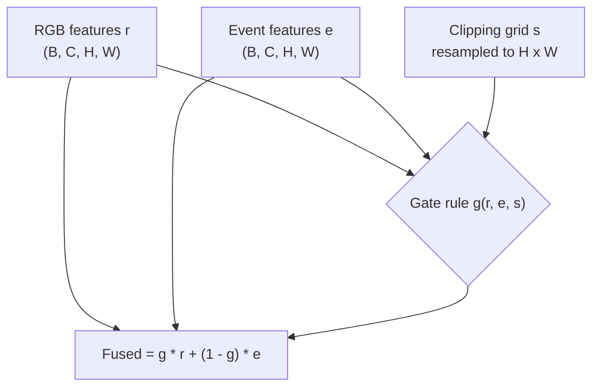
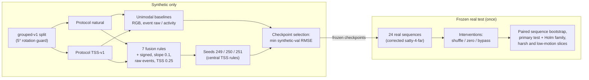

# Architecture and Experiment Design

Diagrams render on GitHub (Mermaid). Exact specifications are in
[`fusion-protocol.md`](fusion-protocol.md); code paths are linked per block.

## 1. End-to-end pipeline

```mermaid
flowchart LR
    subgraph data["Data contract (crop-v2)"]
        Z["FRESH archives<br/>synthetic.zip, real.zip.00x<br/>(zero-copy reads)"]
        A["Annotation-box crop<br/>1.2x square, padded<br/>RGB 0 / event neutral"]
        T["TSS-v1 specular saturation<br/>(protocol 2, RGB only,<br/>deterministic per sample)"]
        C["Clipping grid s<br/>max(RGB) >= 254,<br/>16x16 area average"]
        E["Event encodings<br/>raw / activity / magnitude"]
        K["uint8 memory-mapped cache<br/>per object and role"]
        Z --> A --> T --> C
        A --> E
        C --> K
        E --> K
        T --> K
    end
    subgraph model["Per-object model"]
        R["RGB encoder<br/>HRNet-W18-Small-v2"]
        V["Event encoder<br/>HRNet-W18-Small-v2"]
        F["Per-level fusion<br/>(5 pyramid levels)"]
        D["Shared decoder<br/>1x1 laterals, nearest to 64x64,<br/>conv head"]
        H["J heatmaps<br/>(18 or 26 keypoints)"]
        R --> F
        V --> F
        F --> D --> H
    end
    subgraph pose["Pose and evaluation"]
        P["Argmax + quarter-pixel decode"]
        N["EPnP + LM refinement<br/>(failure = FRESH default pose)"]
        M["ARE / ATE / 10°-10 mm success<br/>sequence bootstrap, slices"]
        P --> N --> M
    end
    K --> R
    K --> V
    K -- "s" --> F
    H --> P
```

Code: `src/saga_pose/data/` (archives, dataset, augment, representations,
cache, real), `src/saga_pose/models/` (heatmaps, fusion),
`src/saga_pose/evaluation/` (pose, metrics, bootstrap),
`src/saga_pose/training/engine.py`.

## 2. Fusion at one pyramid level

| Rule | Gate | Fusion parameters | Uses s |
| --- | --- | ---: | :---: |
| `mean` | 0.5 | 0 | no |
| `concat` | 1x1 conv over [r, e] (no gate) | 2.80 M | no |
| `content_gate` | σ(W[r,e] + c) | 2.80 M | no |
| `clip_gate` (proposed) | σ(b − softplus(a)·s), monotone | 3,968 | yes |
| `clip_gate_constant` (control) | σ(b − softplus(a)·0) | 3,968 | no |
| `clip_gate_fixed` | 0.5·(1 − [s ≥ 0.01]) | 0 | yes |
| `content_clip_gate` | σ(W[r,e] + c − softplus(a)·s) | 2.80 M | yes |
| `clip_gate_signed` (ablation) | σ(b + w·s), free sign | 3,968 | yes |

Interventions at evaluation: shuffle s within each sample, zero s, or force
every gate to 0.5.

## 3. Experimental design

Primary pre-registered comparison: `content_clip_gate` vs `content_gate`
(TSS-trained), co-primary sequence-mean ARE and ATE on the real test.
