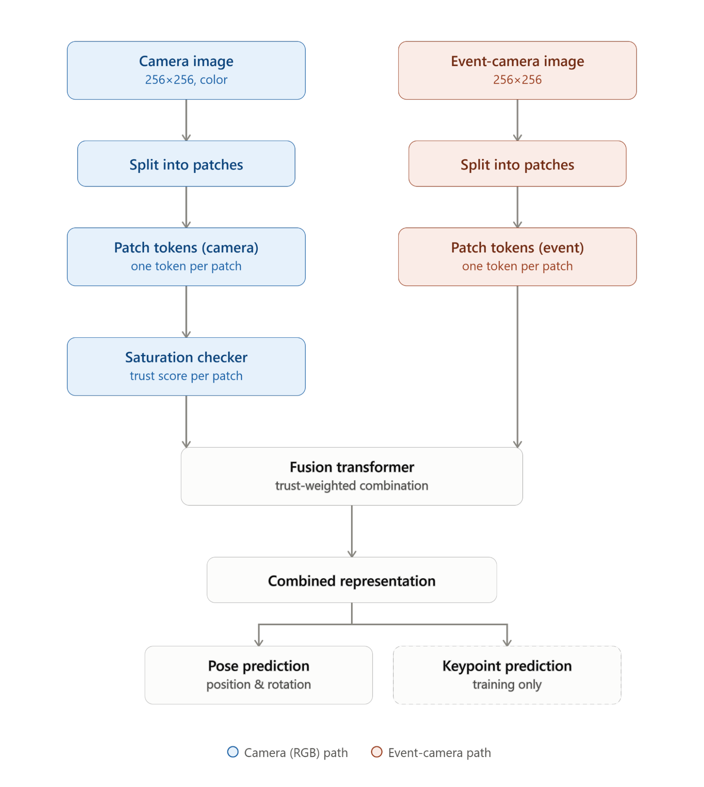

# Project Proposal: Intelligent Autonomous Systems 249

## Team members

| Name | Email | Student ID |
| --- | --- | --- |
| Advait Shinde | advait.shinde@sjsu.edu | 019129500 |
| Jasper Morgal | jasper.morgal@sjsu.du | 015863016 |

## Saturation-Gated Attention Fusion for Event–RGB Spacecraft Pose Estimation Under Harsh Lighting

### Motivation

Autonomous spacecraft proximity operations (rendezvous, docking, on-orbit servicing) depend on vision-based relative pose estimation.

Direct sunlight and reflective Multi-Layer Insulation routinely saturate RGB cameras, destroying the visual information a pose estimator needs at exactly the moments when precise pose is most safety-critical.

Event cameras don't saturate the same way, so RGB–event fusion is the obvious mitigation. Gated attention fusion between RGB and events has already been shown to work, just in a different domain and on a different dataset (Shi et al., 2025, small-object detection under difficult exposure).

The current published state of the art in this specific niche (Jawaid, Märtens & Chin, 2025/2026) deliberately avoids learned attention-based fusion, arguing it risks overfitting: attention has enough learnable parameters to fit synthetic-only training data in a way that may not transfer to real harsh-lighting conditions.

This project tests that claim rather than assuming it, by building a fusion mechanism with attention's representational flexibility but a much smaller, physically-grounded parameter budget — and checking whether any benefit comes from the physical signal itself, not just from having fewer parameters.

## 1. Problem Formulation

### 1.1 Domain problem statement

Given a spacecraft proximity-operations scenario with a non-cooperative or cooperative target, estimate the 6-degree-of-freedom (6-DoF) relative pose of the target with respect to the camera frame at each timestep, under illumination conditions that include direct-glare, blooming, overexposure, and lens-flare artifacts severe enough to destroy usable structure in the RGB channel alone.

The problem is not merely "robust perception under noise" glare produces genuine information loss in RGB, not corruption that better filtering can recover.

The domain problem is therefore specifically a multi-modal information-recovery problem: can a co-registered, non-saturating sensor (an event camera) supply the missing structural information, and can a fusion mechanism decide, per spatial region, how much to trust each modality, in a way that holds up when trained only on synthetic data and evaluated on real hardware?

### 1.2 Inputs

A regular color camera image (256×256 pixels, resized to fit the available compute).

Matching data from an event camera, which records only pixel-level brightness changes instead of a full image this is what lets it avoid overexposure. Both cameras look through the same beamsplitter (a partly-reflective mirror), so their images line up pixel-for-pixel automatically; no extra alignment step is needed.

The event data comes in two possible forms, and both will be tried: a ready-made "event image" the dataset already provides, or the raw list of individual brightness-change events, converted into a small image ourselves.

Both inputs are captured at (nearly) the same instant. The project works one image pair at a time; it does not track a target across a video (that's a possible future extension, not part of this project).

### 1.3 Outputs

- **Main output:** the target's position (a 3D point, in meters) and orientation (a rotation), in the same format the dataset already uses.
- **Helper output, used only during training:** predicted 2D locations of a few known points on the spacecraft. This gives the model an easier, more direct signal to learn from.
- **Inspection output, not part of the task itself:** for each small patch of the image, a score from 0 to 1 showing how much the model trusted the regular camera versus the event camera at that spot. This score is how we'll check whether the new method is actually doing what we intend.

### 1.4 Target metrics and success criteria

Following the standard errors used in spacecraft pose-estimation benchmarks, we will use:

- **Average Rotation Error (ARE):** angle between predicted and ground-truth rotation, in degrees.
- **Average Translation Error (ATE):** Euclidean distance between predicted and ground-truth translation, normalized by target range, in the dataset's native units.

**Headline metric:** the generalization gap: for each fusion method, Δ = error(real test) − error(synthetic validation). This is the number the project's hypothesis depends on, and it is reported for ARE and ATE separately, alongside the absolute error values (a smaller gap doesn't count for much if it comes from doing worse on synthetic data).

**Concrete success criteria:**

1. **Competence check:** the proposed saturation-gated fusion model must reach synthetic-validation ARE/ATE within roughly 10–15% of a fully-learned-attention baseline built at matched architecture depth (i.e., restricting the gate's parameter budget should not simply degrade the model.)

2. **Primary hypothesis test:** the saturation-gated model shows a smaller Δ (generalization gap) than the fully-learned-attention baseline, with the difference assessed via bootstrap 95% confidence intervals over the 24 real sequences (chosen because the real split is small enough that a raw point estimate isn't trustworthy on its own).

3. **Comparative bar:** the saturation-gated model achieves lower real-test ARE/ATE than a reproduced classical RANSAC-fusion baseline (the current published SOTA for this exact dataset), OR if it does not the project reports a clearly characterized accuracy/interpretability/compute trade-off. A well-documented negative result on criterion 2 or 3 still satisfies the project's actual goal, which is testing a specific claim in the literature, not guaranteeing a win.

4. **Mechanistic evidence:** a measurable, reported difference in attention entropy and/or effective rank between the gated and fully-learned models on real harsh-lighting frames, to support a causal story for whichever quantitative result is observed.

5. **Causal check:** evaluate the trained gated model with its saturation input shuffled, and separately evaluate a fixed, non-learned version of the gate built from the raw clipping signal. If shuffling the input doesn't hurt performance, the model isn't actually using the signal in a meaningful way.

Architecture, thresholds, and checkpoint selection are frozen using synthetic validation only, before any evaluation on the real test set. We run a few training seeds for the central comparison and report seed variance separately from the sequence-level bootstrap interval.

## 2. Proposed Technical Approach

### 2.1 High-level architecture

### 2.2 Chosen models / backbone

A compact Vision Transformer (ViT-Small/Tiny scale, or a lightweight CNN-stem + shallow transformer hybrid), 6–8 encoder blocks, hidden dimension 384–512, 16×16 patches at 256×256 input (256 tokens per modality).

This scale is chosen specifically to fit comfortably within a local GPU, and can be upgraded when training on cloud compute.

Rotation output is parameterized as a continuous 6D representation (Zhou et al.-style) rather than raw quaternions, for numerically stable regression this is a standard, well-established choice, not a novel contribution.

Pose recovery follows the same general "regress intermediate variables, recover geometry deterministically" pattern used in recent single-modality spacecraft-pose transformers, adapted here to consume the fused multi-modal representation instead of a single RGB token stream.

### 2.3 Data sources

**Primary dataset:** FRESH (Fusion with RGB and Events for Spacecraft pose estimation under Harsh lighting), University of Adelaide, 2025 — chosen because it is the only publicly available dataset that provides pixel-aligned, temporally synchronized real RGB + event captures specifically under engineered harsh-lighting conditions, with a synthetic-train/real-test protocol that matches this project's hypothesis exactly. ~19.5GB, three synthetic satellite models for training, 24 real sequences for held-out evaluation.

**Stretch/secondary dataset (optional):** SPEED+ or SPARK, used RGB-only (neither provides events), to check whether any RGB-side robustness gained from training the fusion model transfers to a dataset the model was never fused-trained on. Explicitly out of core scope.

### 2.4 What's new relative to prior work

Gated attention fusion between RGB and events isn't new by itself — it's already been used to fuse these two modalities for small-object detection under difficult exposure, in a different domain and dataset (Shi et al., 2025). What we test here is narrower:

- A gate driven by a directly measurable overexposure signal (fraction of clipped pixels per patch — not the same as the "saturation" channel in HSV color space).
- A parameter-matched control: a learned gate with the same number of parameters but no physical signal behind it, to separate "fewer parameters helps" from "this physical signal helps."
- A causal check: shuffling the saturation input and testing a fixed, non-learned gate (Section 1.4).
- Full parameter accounting (total, trainable, fusion-specific) for every variant, since a small gate on top of two fully-trainable encoders doesn't by itself limit model capacity.

### 2.5 Implementation and compute plan

Local prototyping and debugging (tokenizers, gate computation, attention-bias wiring) happens on the RTX 5070 (12GB) using a subset of the synthetic split, at 256×256 resolution with automatic mixed precision.

Full training of all baseline and proposed variants (RGB-only, event-only, fully-learned attention, RANSAC reproduction via the authors' public code, saturation-gated, fixed-gate, shuffled-input control, and the parameter-matched control) runs across both devices, once each is profiled separately for memory and step time — the RTX 5070 and RTX 5060 (8GB) aren't assumed to be interchangeable.

## 3. Device availability and maintainer

| Device | VRAM | Maintainer |
| --- | --- | --- |
| RTX 5070 | 12GB | Jasper Morgal |
| RTX 5060 | 8GB | Advait Shinde |

*Each device is profiled independently before full training runs are assigned to it — see Section 2.5.*
