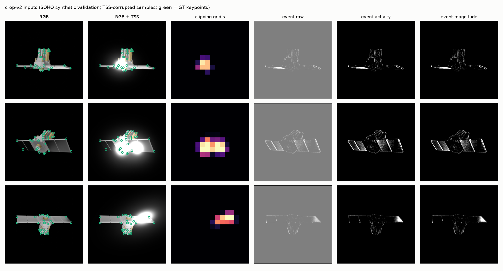
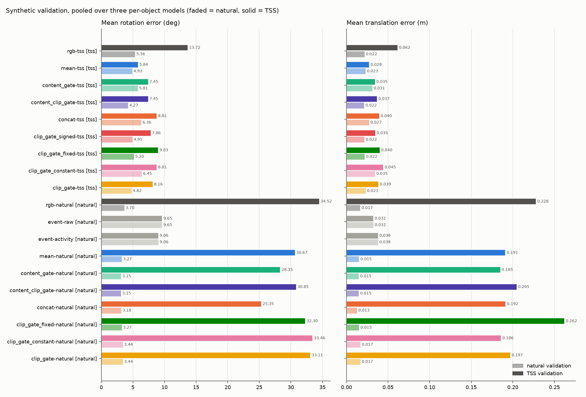
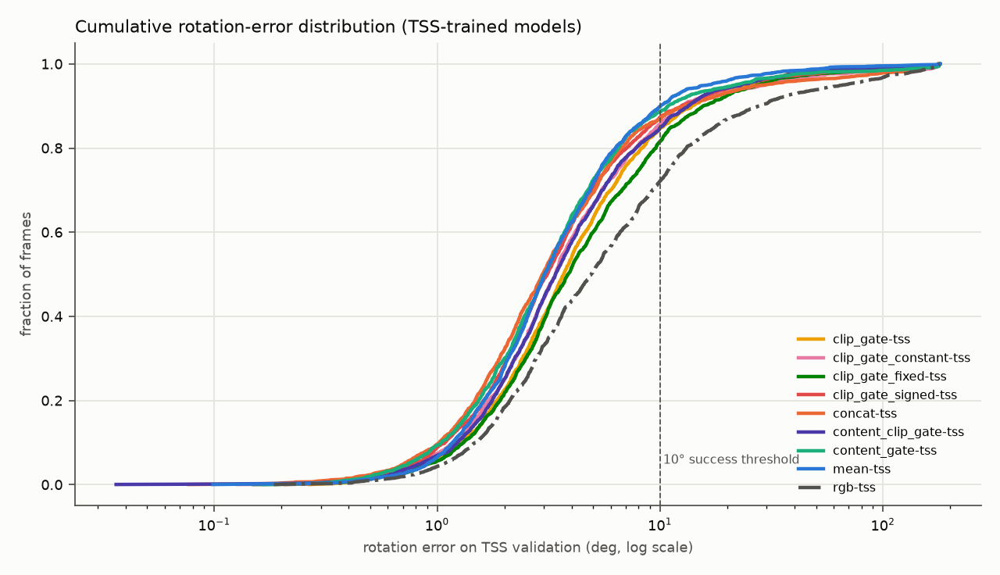
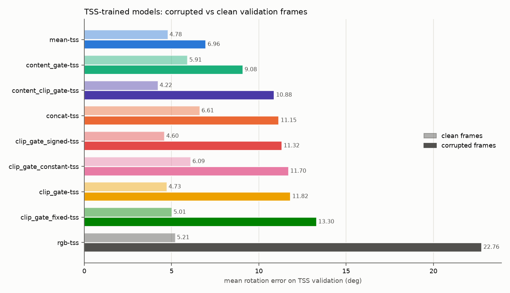
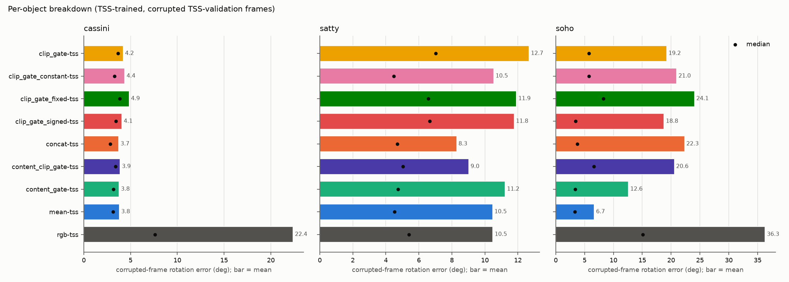
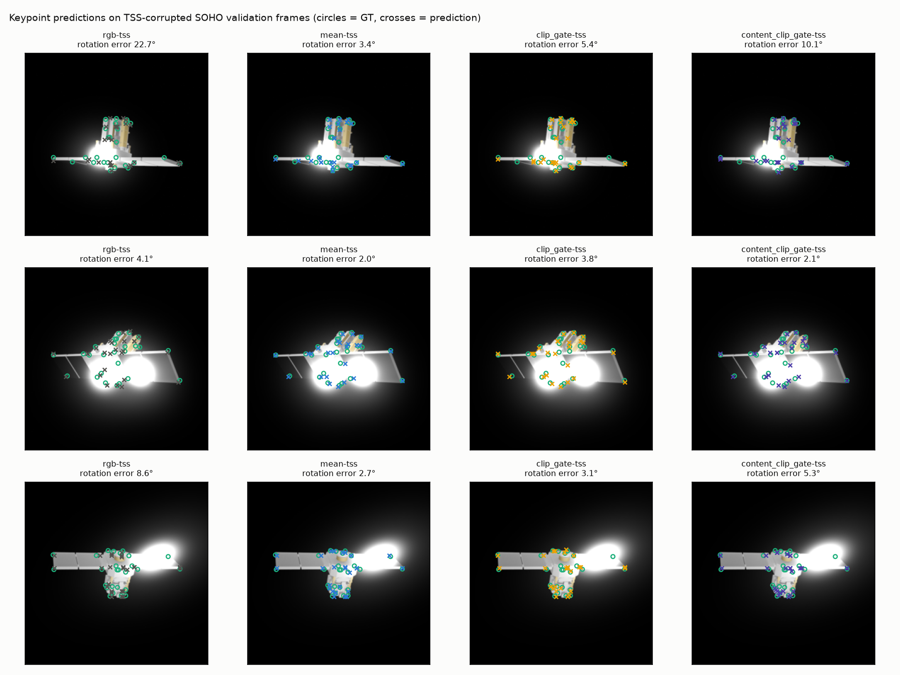
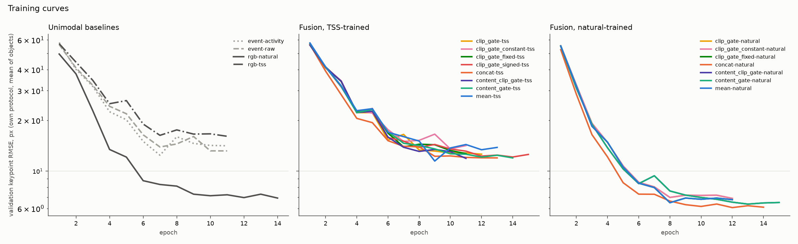
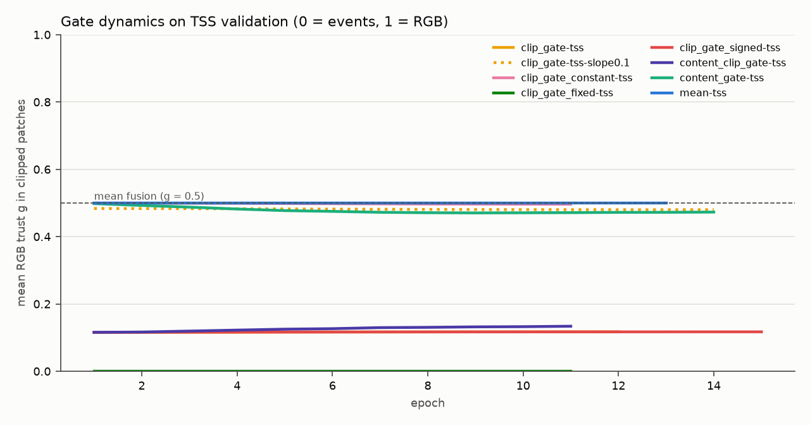

# Results (interim)

**Status (2026-10-06):** 60 of 129 per-object runs of the main matrix are
complete. These include every fusion rule under both protocols, the unimodal
baselines, and the first gate-design ablations. Still to come: raw-event
fusion, the TSS-strength sweep, and seeds 250/251. The real test set has
**not** been evaluated; all numbers below are synthetic validation. They are
single-seed and selection-biased: checkpoints are chosen on the same validation
set that is reported. Treat them as development evidence, not conclusions.

Architecture and design diagrams: [`architecture.md`](architecture.md).
Frozen protocol: [`fusion-protocol.md`](fusion-protocol.md).
Machine-generated tables, regenerated by the scripts shown:
[`outputs/runs/main-hrnet/results.md`](../outputs/runs/main-hrnet/results.md)
(`scripts/report_main.py`) and
[`outputs/runs/main-hrnet/tss_split.md`](../outputs/runs/main-hrnet/tss_split.md)
(`scripts/analyze_tss_split.py`). Figures: `scripts/make_figures.py`.

## Inputs

TSS adds targeted glare to the RGB crop. The clipping grid `s` marks where RGB
is saturated. The event encodings are untouched; synthetic events are binary,
so `activity` and `magnitude` coincide on synthetic data.

## Main comparison (synthetic validation)

Pooled over the three per-object models. "Natural" columns are clean
validation; "TSS" columns are TSS-corrupted validation (about half the frames
corrupted). ARE and ATE are means; success is the share of frames within both
10° and 10 mm.

| Method | Train | Natural ARE | Natural success | TSS ARE | TSS ATE | TSS success | Fusion params |
| --- | --- | ---: | ---: | ---: | ---: | ---: | ---: |
| RGB only | natural | 3.70° | 64.5% | 34.52° | 228 mm | 35.9% | — |
| RGB only | TSS | 5.36° | 48.7% | 13.72° | 62 mm | 38.2% | — |
| Event only (raw) | natural | 9.65° | 47.3% | 9.65° | 33 mm | 47.3% | — |
| Event only (activity) | natural | 9.06° | 42.4% | 9.06° | 38 mm | 42.4% | — |
| **Mean fusion** | TSS | 4.93° | 58.0% | **5.84°** | **28 mm** | **53.2%** | 0 |
| Content gate | TSS | 5.81° | 59.3% | 7.45° | 35 mm | 53.2% | 2.80 M |
| Content + clipping gate | TSS | 4.27° | 52.2% | 7.45° | 37 mm | 46.2% | 2.80 M |
| Concat | TSS | 6.36° | 58.6% | 8.81° | 40 mm | 52.8% | 2.80 M |
| Clipping gate (slope 0.1) | TSS | 5.16° | 59.7% | 6.38° | 33 mm | 53.4% | 3,968 |
| Clipping gate (signed) | TSS | 4.95° | 57.0% | 7.86° | 35 mm | 52.2% | 3,968 |
| Clipping gate | TSS | 4.82° | 54.0% | 8.16° | 39 mm | 48.0% | 3,968 |
| Constant control | TSS | 6.45° | 54.5% | 8.81° | 45 mm | 48.4% | 3,968 |
| Fixed clipping gate | TSS | 5.20° | 52.3% | 9.03° | 40 mm | 46.0% | 0 |
| Concat | natural | 3.18° | 68.3% | 25.35° | 192 mm | 38.8% | 2.80 M |
| Content gate | natural | 3.15° | 62.3% | 28.35° | 185 mm | 34.7% | 2.80 M |
| Mean fusion | natural | 3.27° | 60.0% | 30.67° | 191 mm | 33.2% | 0 |

### Where the errors come from

### Predictions on corrupted frames

### Training and gate dynamics

## What the evidence currently supports

1. **Exposure to saturation during training decides robustness.** Every
   natural-trained model, single-sensor or fused, collapses under TSS (25–35°
   mean ARE). Every TSS-trained fusion model stays below 10°.
2. **Learned fusion beats either sensor under saturation.** TSS-trained mean
   fusion reaches 5.84° on TSS validation, against 13.72° for RGB-only (TSS)
   and 9.06° for event-only.
3. **Explicit clipping routing does not help on synthetic validation, so far.**
   The simplest rule (mean, no parameters) is best under TSS. Strongly
   initialized clipping gates (softplus slope 5) route clipped patches almost
   entirely to events and do worst on exactly the corrupted frames. A weakly
   initialized gate (slope 0.1) learns only slight event routing (RGB trust
   0.48 vs 0.50) and lands near mean fusion. The gate's physical input does
   change predictions: shuffling or zeroing `s` raises RMSE.
4. **Design sanity checks hold exactly.** Under the natural protocol the
   clipping gate equals its constant control, the fixed gate equals mean
   fusion, and the hybrid equals the content gate on clean data, because `s`
   is zero in training.

Caveats: one seed per configuration (seeds 250/251 are queued for the central
rules); effects concentrate in SOHO; validation curves are noisy (see
`val-curve noise` in the generated table); and the real test may differ. The
pre-registered primary comparison (`content_clip_gate` vs `content_gate`,
TSS-trained) is decided only on the frozen real test.
